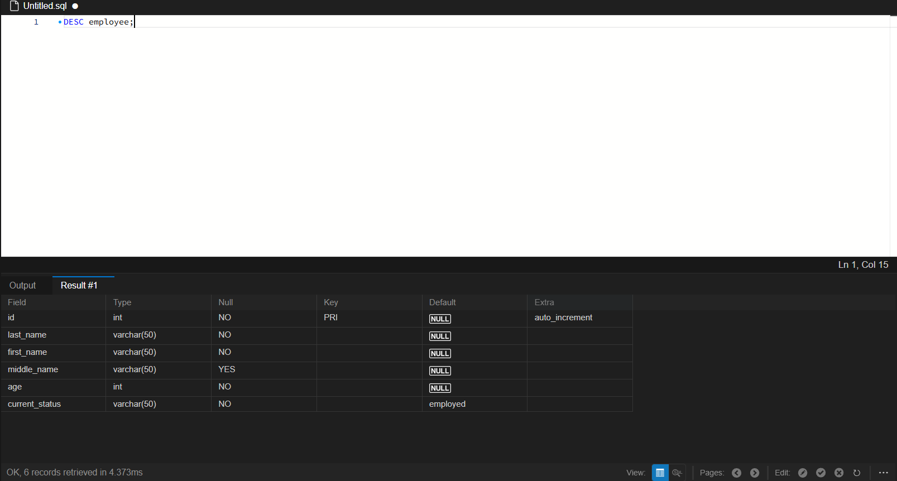

# What is NULL and NOT NULL in MySQL?
- NULL means **no value is stored.**
- The information is missing or unknown.
- When a column allows NULL, a row can be inserted without providing a value for that column. 
- We can use the `DESC <tablename>` command to view different permissions for that table


## USing `NOT NULL`
- Add `NOT NULL` to a column definition when it must always have a value:
```sql
CREATE TABLE pet_shop (
    name VARCHAR(50) NOT NULL,
    age INT NOT NULL
);
```
